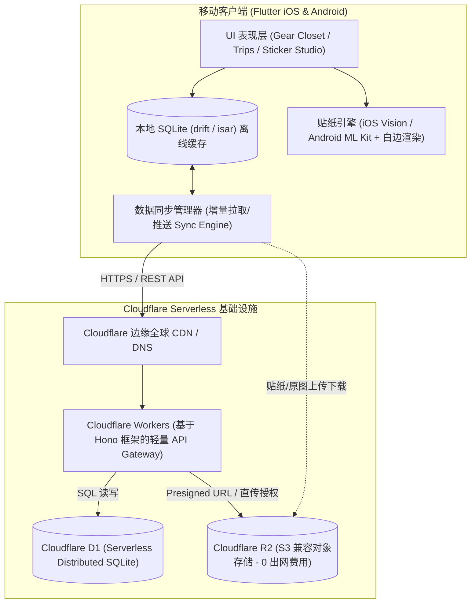
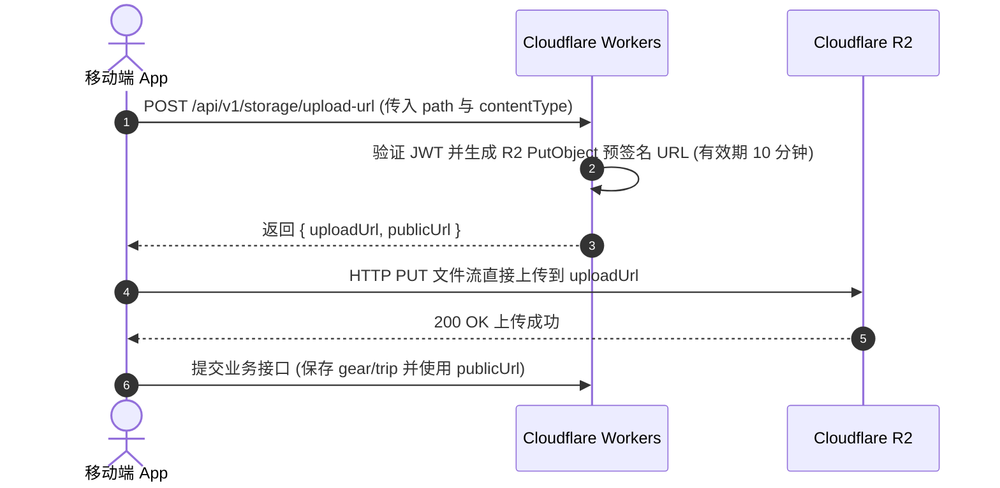

# 🏗️ 技术架构与接口设计文档 — Trail Gear

> 本文档基于 [01-requirements.md](file:///Users/github-lzt/trail-gear/docs/01-requirements.md) 制定，采用 **Flutter (移动客户端) + Cloudflare Serverless (全套无服务器后端)** 架构。实现无传统服务器维护成本、零出网流量费、高并发边缘响应、离线优先（Offline-First）与设备端贴纸抠图渲染。

---

## 一、 系统整体架构



### 1.1 技术选型

| 模块 | 选型 | 理由 |
|---|---|---|
| **移动端框架** | Flutter (Dart) | 单套代码交付高质量 iOS + Android 原生体验，优秀的 Canvas 贴纸渲染与动画能力 |
| **本地数据库** | SQLite (drift / sqflite) | 离线优先架构（户外界外无信号场景仍可完整记录与查看打包清单），支持事务与高效增量同步 |
| **设备端抠图** | iOS Vision (`VNGenerateForegroundInstanceMaskRequest`) / Android ML Kit Subject Segmentation | 纯本地端侧模型毫秒级推理，隐私安全，无需昂贵的云端 GPU 抠图算力 |
| **API 服务层** | Cloudflare Workers + [Hono](https://hono.dev/) | 启动时间为 0ms，全球边缘节点就近响应，轻量级 TypeScript，极高性价比与无服务器运维 |
| **云端关系型数据库** | Cloudflare D1 (Serverless SQLite) | 原生与 SQLite 兼容，与客户端本地 SQLite 数据结构 100% 对齐，支持事务，与 Workers 零延迟绑定 |
| **多媒体对象存储** | Cloudflare R2 | S3 兼容 API，免除出网流量费（Egress Free），原生支持自定义域名与 CDN 强缓存 |
| **认证方案** | JWT (HMAC-SHA256, Web Crypto API) + Password Hash (Argon2id / PBKDF2) | 无状态身份验证，完美契合 Cloudflare Workers Edge 运行环境 |

---

## 二、 Cloudflare D1 数据库设计 (Schema)

所有表均包含 `sync_version`（版本自增整数）或 `updated_at` 时间戳以及 `is_deleted`（软删除标记），以原生支撑**离线增量同步**。

```sql
-- 1. 用户表
CREATE TABLE IF NOT EXISTS users (
    id TEXT PRIMARY KEY,                       -- UUID v4
    email TEXT NOT NULL UNIQUE,                -- 注册邮箱
    password_hash TEXT NOT NULL,               -- PBKDF2 / Argon2 密码散列
    nickname TEXT NOT NULL,                    -- 用户昵称
    avatar_url TEXT,                           -- 头像 R2 URL
    created_at INTEGER NOT NULL,               -- 毫秒级 Unix 时间戳
    updated_at INTEGER NOT NULL                -- 毫秒级 Unix 时间戳
);

-- 2. 装备分类表
CREATE TABLE IF NOT EXISTS categories (
    id TEXT PRIMARY KEY,                       -- 分类 ID (如 'shelter', 'sleep' 或自定义 UUID)
    user_id TEXT,                              -- 关联用户 ID (NULL 表示系统内置默认分类)
    name TEXT NOT NULL,                        -- 分类名称（如：庇护所、睡眠系统、厨具、穿戴、电子、消耗品）
    icon TEXT NOT NULL,                        -- 图标标识 (如 'tent', 'bed', 'pot')
    sort_order INTEGER NOT NULL DEFAULT 0,     -- 排序权重
    is_deleted INTEGER NOT NULL DEFAULT 0,     -- 软删除标记 (0/1)
    updated_at INTEGER NOT NULL,
    FOREIGN KEY(user_id) REFERENCES users(id) ON DELETE CASCADE
);

-- 3. 装备柜（装备明细表）
CREATE TABLE IF NOT EXISTS gears (
    id TEXT PRIMARY KEY,                       -- 装备 UUID
    user_id TEXT NOT NULL,                     -- 所属用户 ID
    category_id TEXT NOT NULL,                 -- 所属分类 ID
    name TEXT NOT NULL,                        -- 装备名称（如：云尚2 双人帐篷）
    brand TEXT,                                -- 品牌（如：Naturehike / MSR）
    model TEXT,                                -- 型号
    weight_grams REAL NOT NULL DEFAULT 0,      -- 重量（克），支持小数点（如 1250.5g）
    description TEXT,                          -- 备注与描述
    original_image_url TEXT,                   -- 原始拍摄照片 R2 URL
    sticker_image_url TEXT,                    -- 抠图并带白边贴纸 PNG R2 URL
    is_archived INTEGER NOT NULL DEFAULT 0,    -- 是否归档/闲置 (0/1)
    is_deleted INTEGER NOT NULL DEFAULT 0,     -- 软删除 (0/1)
    created_at INTEGER NOT NULL,
    updated_at INTEGER NOT NULL,
    FOREIGN KEY(user_id) REFERENCES users(id) ON DELETE CASCADE,
    FOREIGN KEY(category_id) REFERENCES categories(id)
);

CREATE INDEX IF NOT EXISTS idx_gears_user_updated ON gears(user_id, updated_at);
CREATE INDEX IF NOT EXISTS idx_gears_category ON gears(category_id);

-- 4. 行程表
CREATE TABLE IF NOT EXISTS trips (
    id TEXT PRIMARY KEY,                       -- 行程 UUID
    user_id TEXT NOT NULL,                     -- 所属用户 ID
    title TEXT NOT NULL,                       -- 行程名称（如：武功山两日反穿）
    description TEXT,                          -- 行程描述 / 备忘录
    start_date INTEGER NOT NULL,               -- 开始日期（毫秒时间戳）
    end_date INTEGER NOT NULL,                 -- 结束日期（毫秒时间戳）
    cover_image_url TEXT,                      -- 行程封面 R2 URL
    status TEXT NOT NULL DEFAULT 'planning',   -- 状态：planning(筹备中), active(进行中), completed(已归档)
    is_deleted INTEGER NOT NULL DEFAULT 0,     -- 软删除
    created_at INTEGER NOT NULL,
    updated_at INTEGER NOT NULL,
    FOREIGN KEY(user_id) REFERENCES users(id) ON DELETE CASCADE
);

CREATE INDEX IF NOT EXISTS idx_trips_user_updated ON trips(user_id, updated_at);

-- 5. 行程打包清单明细表（多对多关联）
CREATE TABLE IF NOT EXISTS trip_items (
    id TEXT PRIMARY KEY,                       -- 关联项 UUID
    trip_id TEXT NOT NULL,                     -- 行程 ID
    gear_id TEXT NOT NULL,                     -- 装备 ID
    is_packed INTEGER NOT NULL DEFAULT 0,      -- 是否已打包 (0: 未打包, 1: 已打包 ✅)
    custom_quantity INTEGER NOT NULL DEFAULT 1,-- 数量（默认 1）
    sort_order INTEGER NOT NULL DEFAULT 0,     -- 自定义排序
    is_deleted INTEGER NOT NULL DEFAULT 0,     -- 软删除
    updated_at INTEGER NOT NULL,
    FOREIGN KEY(trip_id) REFERENCES trips(id) ON DELETE CASCADE,
    FOREIGN KEY(gear_id) REFERENCES gears(id) ON DELETE CASCADE
);

CREATE INDEX IF NOT EXISTS idx_trip_items_trip ON trip_items(trip_id);
```

---

## 三、 Cloudflare R2 对象存储设计

### 3.1 目录组织结构

```text
trail-gear-r2-bucket/
├── users/{user_id}/
│   ├── avatar.webp                          # 用户头像
│   ├── gears/{gear_id}/
│   │   ├── original.webp                    # 压缩后的原图备份 (WebP/JPEG)
│   │   └── sticker.png                      # 抠图 + 白边透明背景 PNG (带圆润描边)
│   └── trips/{trip_id}/
│       └── cover.webp                       # 行程封面图
```

### 3.2 上传工作流程（Presigned URL 直传）

为降低 Workers 边缘函数的 CPU 消耗与带宽开销，图片上传采用 **预签名 URL (Presigned S3 Upload URL)** 模式：



---

## 四、 RESTful API 规范 (Cloudflare Workers + Hono)

所有接口统一前缀：`/api/v1`。  
统一返回数据结构：
```json
{
  "code": 0,           // 0 表示成功，非 0 为具体业务错误码
  "message": "success",
  "data": { ... }
}
```

### 4.1 认证模块 (`/auth`)

| 端点 | 方法 | 描述 | 权限 |
|---|---|---|---|
| `/auth/register` | `POST` | 邮箱密码注册（密码强哈希校验，生成默认系统分类） | 公开 |
| `/auth/login` | `POST` | 邮箱密码登录，返回 JWT Token 及用户基础信息 | 公开 |
| `/auth/me` | `GET` | 获取当前登录用户个人资料 | Bearer Token |
| `/auth/profile` | `PUT` | 修改昵称、头像等资料 | Bearer Token |

### 4.2 存储凭据模块 (`/storage`)

| 端点 | 方法 | 描述 | 权限 |
|---|---|---|---|
| `/storage/upload-url` | `POST` | 获取 R2 上传预签名 URL（支持指定 `gear_image`、`trip_cover` 等类型） | Bearer Token |

### 4.3 装备柜模块 (`/gears`)

| 端点 | 方法 | 描述 | 权限 |
|---|---|---|---|
| `/categories` | `GET` | 获取系统默认分类及用户自定义分类列表 | Bearer Token |
| `/categories` | `POST` | 创建自定义分类 | Bearer Token |
| `/gears` | `GET` | 分页/筛选获取装备列表（支持 `category_id`、`search`、`is_archived`） | Bearer Token |
| `/gears` | `POST` | 新增装备（包含贴纸 URL、名称、品牌、重量等） | Bearer Token |
| `/gears/:id` | `GET` | 获取单个装备详细信息 | Bearer Token |
| `/gears/:id` | `PUT` | 更新装备信息（重新拍照、修改重量等） | Bearer Token |
| `/gears/:id` | `DELETE` | 软删除装备 | Bearer Token |

### 4.4 行程与打包清单模块 (`/trips`)

| 端点 | 方法 | 描述 | 权限 |
|---|---|---|---|
| `/trips` | `GET` | 获取行程列表（按开始时间倒序，包含总装备数、已打包数、基础重量汇总） | Bearer Token |
| `/trips` | `POST` | 创建新行程（标题、描述、起止日期、封面） | Bearer Token |
| `/trips/:id` | `GET` | 获取行程详情及打包清单物品详情 | Bearer Token |
| `/trips/:id` | `PUT` | 修改行程基本信息 | Bearer Token |
| `/trips/:id` | `DELETE` | 删除行程 | Bearer Token |
| `/trips/:id/items` | `POST` | 批量向清单添加装备 `[{ gear_id, custom_quantity }]` | Bearer Token |
| `/trips/:id/items/:item_id` | `PATCH` | 切换打包状态 `{ is_packed: true/false }` | Bearer Token |
| `/trips/:id/items/:item_id` | `DELETE` | 从清单中移出装备 | Bearer Token |

### 4.5 离线增量双向同步模块 (`/sync`)

户外场景经常无信号或弱网，客户端本地完成的打包标记、新增装备需支持离线操作。

| 端点 | 方法 | 描述 |
|---|---|---|
| `/sync/pull` | `POST` | 客户端传入 `last_sync_timestamp`，服务端返回该时间戳后所有变更的 categories、gears、trips、trip_items |
| `/sync/push` | `POST` | 客户端批量提交离线产生的创建/修改/删除批次操作，服务端通过 Last-Write-Wins 规则合并并返回最新状态 |

---

## 五、 客户端核心技术攻关：贴纸工坊 (Sticker Studio)

贴纸效果是产品的核心视觉与交互卖点。

```text
[ 用户拍照/相册选择 ]
         │
         ▼
[ 1. 端侧智能主体抠图 (iOS Vision / Android ML Kit) ]
   - 生成 Alpha 遮罩 (Foreground Mask)
   - 提取出清晰的物品前景对象，背景变全透明
         │
         ▼
[ 2. 贴纸白色描边算法 (Sticker Outline Generation) ]
   - 方法 A (CPU/Image): 图像 Alpha 通道膨胀算子 (Morphological Dilation)，膨胀 12~18px 并填充白色
   - 方法 B (Flutter Canvas): 绘制多角度高斯偏移叠加白色 Mask，或使用 Skia/Impeller 轮廓 Shader
   - 底部附加一层极弱半透明环境柔和投影 (Drop Shadow, 6% black)，营造真实立体贴纸感
         │
         ▼
[ 3. 贴纸卡片渲染与存储 ]
   - 生成 1:1 透明背景 PNG 贴纸，保存于本地沙盒
   - 联网时同步上传到 Cloudflare R2
   - 在装备柜以网格流配合微倾斜（-2° ~ +2° 随机微旋）呈现手账贴纸风格
```

---

## 六、 需要提供的 Cloudflare 资源清单

为了在本项目中完成 Cloudflare Workers、D1 数据库与 R2 存储的直接部署与自动化接入，需要您提供以下配置：

### 📋 需用户提供的配置项

| 配置项 | 说明 | 示例 |
|---|---|---|
| **1. Cloudflare Account ID** | 在 Cloudflare 控制台右侧侧边栏或 URL 中可见（32位字符） | `a1b2c3d4e5f6...` |
| **2. Cloudflare API Token** | 具有 Workers, D1, R2 编辑权限的 API 令牌（可在 My Profile -> API Tokens 中创建） | `Bearer xxxxxxx` |
| **3. D1 数据库名称** | 准备创建或已创建的 D1 数据库名（例如 `trail-gear-db`），如已有则告知 `database_id` | `trail-gear-db` |
| **4. R2 存储桶名称** | 准备用于存储图片的 R2 桶名（例如 `trail-gear-assets`） | `trail-gear-assets` |
| **5. R2 公共访问域名 (可选)** | R2 Bucket 绑定的自定义域名或 Workers CDN 路由域名（用于客户端加载图片） | `assets.trailgear.app` 或 R2.dev 预览域名 |
| **6. JWT Secret 密钥** | 用于签发鉴权 Token 的随机安全字符串（可由我代为生成随机安全串） | 随机字符串 |

> 💡 **提示**：如果您的本地终端已通过 `npx wrangler login` 授权过，也可直接告知，我可以通过 Wrangler 脚本自动执行 `wrangler d1 create` 和 `wrangler r2 bucket create`！
